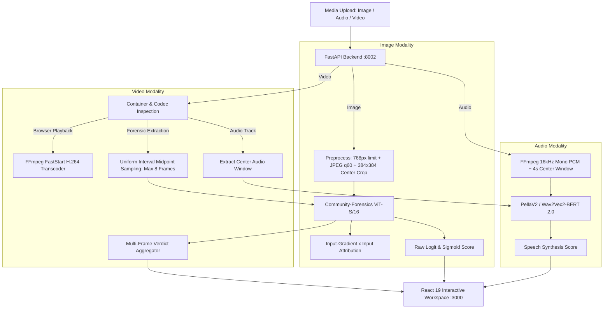

# TruthLens: Multimodal Deepfake & Synthetic Media Forensic Engine

[](https://github.com/adoraeden/Truthlens)
[](frontend/)
[](src/)
[](LICENSE)

TruthLens is a multimodal forensic screening engine developed for **NEURAL STORM 2026** under **Problem Statement FT-02: Deepfake & Synthetic Media Detection**. It provides newsrooms, digital forensic analysts, and platforms with an assistive review tool to inspect uploaded **images**, **audio clips**, and **video recordings** for visual, spectral, and semantic indicators of AI generation.

---

## 1. Problem Statement & Motivation

> **Track & Statement**: **FT-02 Deepfake & Synthetic Media Detection**
> *"Build a multimodal detection engine to identify AI-generated images, videos, and audio and flag disinformation at scale."*

### The Challenge
Generative diffusion models, voice cloners, and neural video synthesizers can now produce hyper-realistic faces, voices, and events. Automated binary detectors often suffer from catastrophic false-positive spikes when encountering unseen generator architectures, phone microphone compressions, or HEVC video codecs.

### TruthLens Approach
TruthLens avoids "black-box binary verdict" overconfidence:
- **Conservative Multi-Evidence Logic**: Video verdicts aggregate per-frame detections into three distinct states (`LIKELY REAL`, `MIXED EVIDENCE`, and `AI-GENERATED`). An isolated flagged frame does not erroneously condemn an entire recording.
- **Explainable Attribution**: Provides positive input-gradient attribution maps, high-frequency noise residuals, Error Level Analysis (ELA), and RGB distribution diagnostics.
- **HEVC / Device Compatibility**: Transparently detects browser-incompatible device codecs (such as H.265/HEVC recorded on smartphones) and generates fast, streamable H.264 MP4 previews while ensuring the uncompressed original media is always routed to the underlying neural detectors.
- **Honest Statistical Calibration**: Clearly separates raw model logits, uncalibrated sigmoid confidence scores, and probability estimates.

---

## 2. Architecture & Multimodal Pipeline



### Modality Specifications
1. **Image Lab**:
   - **Backbone**: Fine-tuned Vision Transformer (ViT-Small/16) from `Thermostatic/community-forensics-frontier-detector-2026-08`.
   - **Input Processing**: Rescaled to max 768px long edge, JPEG quality 60 compressed (anti-artifact normalization), resized to 440px short edge, and center-cropped to 384×384 (576 patches of 16×16).
   - **Decision Boundary**: Configurable raw-logit threshold (default: `0.0`, with backward-compatible override `TRUTHLENS_IMAGE_LOGIT_THRESHOLD`).
   - **Diagnostics**: Model attribution heatmap, Error Level Analysis (ELA), Noise Residual analysis, and RGB compression histograms.

2. **Audio Lab**:
   - **Backbone**: PellaV2 with `facebook/w2v-bert-2.0` foundation weights.
   - **Input Processing**: FFmpeg resamples audio to 16 kHz single-channel mono PCM. Clips under 4s are zero-padded; longer clips extract a central 4-second temporal window.
   - **Memory Resilience**: Integrated RAM preflight guard (configured down to 3.5 GB min RAM) ensures stability on shared or lightweight host nodes.

3. **Video Lab**:
   - **Visual Sampling**: Uniform interval midpoint extraction sampling up to 8 frames per clip.
   - **Verdict Aggregation**:
     - `0 flagged frames`: **LIKELY REAL**
     - `1 to N-1 flagged frames`: **MIXED EVIDENCE** (Flags temporal anomalies or isolated artifacts requiring expert human review)
     - `All sampled frames flagged`: **AI-GENERATED**
   - **Playback Pipeline**: Dual-track handling: server-side background H.264 preview generation for browser compatibility (`POST /api/convert/video-preview`) while guaranteeing forensic inference receives the untranscoded master copy.

---

## 3. Technology Stack

- **Frontend**: React 19, TypeScript, Vite 8, Tailwind CSS v4, Lucide Icons, Motion.
- **Backend**: Python 3.12, FastAPI, Uvicorn, Starlette, Pydantic v2.
- **Machine Learning & Vision**: PyTorch, Torchvision, Torchaudio, Transformers, TIMM, OpenCV (cv2), Pillow, NumPy, SciPy.
- **Audio Processing**: SoundFile, Librosa, Pyloudnorm.
- **Media Engine**: FFmpeg / FFprobe (audio transcoding, video frame extraction, H.264 browser conversions).

---

## 4. Measured Evaluation Results & Limitations

### Exploratory GenImage Validation Benchmark
Evaluated across a stratified 400-sample test slice (200 AI-generated across 8 generator architectures, 200 natural images) from the Kaggle GenImage mirror (`vtphatt2/genimage-validation`):

| Operating Point | Threshold (Logit) | Overall Accuracy | Precision | AI Recall | False Positive Rate |
| :--- | :---: | :---: | :---: | :---: | :---: |
| **Balanced (Default)** | **0.0** | **90.5%** | **97.65%** | **83.0%** | **2.0%** |
| High-Precision Mode | 2.0 | 86.5% | 98.67% | 74.0% | 1.0% |

#### Generator Robustness Breakdown (at threshold = 0.0)
- **Stable Diffusion v1.5**: 100.0% Detection
- **Wukong**: 100.0% Detection
- **GLIDE & SD v1.4**: 98.0% Detection
- **Midjourney**: 94.0% Detection
- **BigGAN**: 82.0% Detection
- **VQDM**: 80.0% Detection
- **ADM**: 72.0% Detection (challenging diffusion boundary)

### Critical Forensic Limitations
- **Not Calibrated Probabilities**: Displayed confidence values are threshold-relative sigmoid mappings, not mathematical Bayesian posterior probabilities.
- **Crop Invariant**: Image analysis inspects a central 384×384 window; manipulation isolated entirely to outer borders will not register in the ViT feature maps.
- **Acoustic Replay Limitation**: PellaV2 reliably spots synthetic vocoder anomalies in direct digital streams, but synthetic speech played through a physical speaker and re-recorded via a smartphone microphone may exhibit acoustic room impulse responses that cause false negatives.
- **Temporal Blindspots**: Uniform 8-frame video sampling does not evaluate every micro-frame; microsecond face swaps between sample windows require targeted manual inspection.

---

## 5. Local Setup & Execution Guide

### Prerequisites
- **OS**: Windows, macOS, or Linux
- **Python**: 3.11 or 3.12
- **Node.js**: v18+ and `npm`
- **FFmpeg & FFprobe**: Installed and available in system `PATH`

### 1. Backend Setup
```powershell
# Navigate to the repository root
Set-Location 'C:\Users\adora\DeepfakeLab'

# Create and activate virtual environment (if not already created)
python -m venv .venv
.\.venv\Scripts\Activate.ps1

# Install dependencies
pip install -r requirements.txt

# Start FastAPI backend (runs on http://127.0.0.1:8002)
$env:TRUTHLENS_IMAGE_LOGIT_THRESHOLD = "0.0"
$env:TRUTHLENS_PELLA_MIN_RAM_GB = "3.5"
python -m uvicorn src.api_server:app --host 127.0.0.1 --port 8002
```

### 2. Frontend Setup
```powershell
# In a new terminal window:
Set-Location 'C:\Users\adora\DeepfakeLab\frontend'

# Install Node dependencies
npm install

# Launch Vite development server (runs on http://localhost:3000)
npm run dev
```

Open your browser at `http://localhost:3000`. The Vite development server automatically proxies `/api` requests to the FastAPI backend running at `http://127.0.0.1:8002`.

---

## 6. Pretrained Models, Licenses & Transparency

In compliance with hackathon rules, TruthLens is transparent about its components:
1. **Image Detector Checkpoint**: `Thermostatic/community-forensics-frontier-detector-2026-08` (ViT-Small/16 architecture trained on community synthetic datasets).
2. **Audio Detector Backbone**: `Sadanie/PellaV2` with `facebook/w2v-bert-2.0` feature representation.
3. **Exploratory Evaluation Dataset**: GenImage validation benchmark subset (`vtphatt2/genimage-validation`, CC BY-NC-SA 4.0).
4. **AI Tooling Disclosure**: Claude Sonnet and Gemini AI were utilized for code review, TypeScript refactoring, testing suite automation, and documentation synthesis. Core detector inference architectures and model checkpoints were authored by external research teams as cited above.

---

## 7. Automated Testing Suite

To verify the complete system integrity:

```powershell
# Backend unit & integration tests
pytest tests/test_api_endpoints.py tests/test_detectors.py

# Frontend TypeScript & suite validation
Set-Location 'frontend'
npm run lint
npm run build
```
