# TruthLens: Multimodal Deepfake & Synthetic Media Forensic Engine

[](https://github.com/adoraeden/Truthlens)
[](frontend/)
[](src/)

TruthLens is a multimodal forensic screening engine developed for **NEURAL STORM 2026** under **Problem Statement FT-02: Deepfake & Synthetic Media Detection**.

It provides newsrooms, digital forensic analysts, and platforms with an assistive review tool to inspect uploaded images, audio clips, and video recordings for visual, spectral, and other indicators of AI generation.

**Problem Statement:** FT-02 — Deepfake & Synthetic Media Detection  
**Team Name:** SyntaxError

**Team Members:**
- Adora Eden

---
## Competition Achievement

**NEURAL STORM 2026 — 98th Rank out of 329 participating teams**

TruthLens was developed for Problem Statement FT-02: Deepfake & Synthetic Media Detection.

---
# TruthLens: Multimodal Deepfake & Synthetic Media Forensic Engine

[Keep your existing introduction and project description here.]

## Demo Video

Watch the complete TruthLens demonstration, covering the image, audio, and video detection workflows, forensic analysis, and project architecture.

Watch the TruthLens Demo: https://drive.google.com/file/d/1g4pe0x7OaICENe-HBYVsj1mlpCGY0JVy/view?usp=sharing

---

## 1. Problem Statement & Motivation

[Keep the rest of your existing README unchanged.]

## 1. Problem Statement & Motivation

**Track:** FT-02 — Deepfake & Synthetic Media Detection

> Build a multimodal detection engine to identify AI-generated images, videos, and audio and flag disinformation at scale.

### The Challenge

Generative diffusion models, voice-cloning systems, and neural video synthesizers can produce increasingly realistic faces, voices, and events.

Automated binary detectors can produce false positives or false negatives when encountering unfamiliar generator architectures, compressed media, smartphone recordings, and different video codecs.

### TruthLens Approach

TruthLens aims to avoid overconfident black-box verdicts through multiple forensic indicators and transparent reporting.

- **Conservative Multi-Evidence Logic:** Video verdicts aggregate sampled-frame detections into three states: LIKELY REAL, MIXED EVIDENCE, and AI-GENERATED. An isolated flagged frame does not automatically classify an entire recording as AI-generated.
- **Explainable Attribution:** Provides input-gradient attribution maps, high-frequency noise residuals, Error Level Analysis (ELA), and RGB distribution diagnostics.
- **HEVC / Device Compatibility:** Generates browser-compatible H.264 MP4 previews for videos using codecs such as H.265/HEVC, while ensuring that forensic inference always uses the original uploaded media.
- **Honest Statistical Reporting:** Clearly distinguishes raw model logits, uncalibrated sigmoid-transformed scores, and calibrated probabilities. Probability estimates are withheld when production calibration is unavailable.

---

## 2. Architecture & Multimodal Pipeline

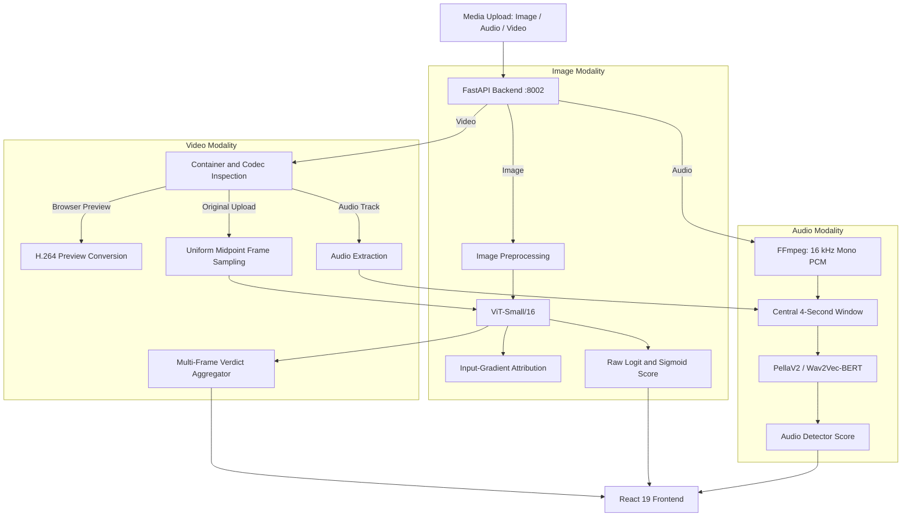

### Modality Specifications

#### 1. Image Lab

- **Backbone:** Fine-tuned Vision Transformer (ViT-Small/16) based on the `Thermostatic/community-forensics-frontier-detector-2026-08` checkpoint.
- **Input Processing:** Rescaled to a maximum 768px long edge, JPEG quality 60 normalization, resized to a 440px short edge, and center-cropped to 384×384, producing 576 patches of 16×16.
- **Decision Boundary:** Configurable raw-logit threshold, defaulting to 0.0, with the `TRUTHLENS_IMAGE_LOGIT_THRESHOLD` environment variable.
- **Diagnostics:** Model attribution heatmap, Error Level Analysis (ELA), Noise Residual analysis, and RGB distribution and compression diagnostics.

#### 2. Audio Lab

- **Backbone:** PellaV2 with `facebook/w2v-bert-2.0` foundation weights.
- **Input Processing:** FFmpeg resamples audio to 16 kHz, single-channel mono PCM. Clips shorter than four seconds are zero-padded, while longer clips use a central four-second temporal window.
- **Memory Resilience:** Includes a RAM preflight guard with a configurable minimum memory requirement. The current default is 3.5 GB.

#### 3. Video Lab

- **Visual Sampling:** Uniform interval midpoint extraction, analysing up to eight frames per clip.
- **Verdict Aggregation:**
  - **0 flagged frames:** LIKELY REAL.
  - **1 to N-1 flagged frames:** MIXED EVIDENCE. Isolated detections or disagreement across sampled frames require manual review.
  - **All sampled frames flagged:** AI-GENERATED indicators detected across all sampled frames.
- **Playback Pipeline:** Server-side FFmpeg conversion creates browser-compatible H.264 previews through `POST /api/convert/video-preview`. The original uploaded file is always used for forensic inference; preview conversion does not replace the analysis input.
- **Audio Analysis:** When an audio track is available and the audio detector loads successfully, it is extracted and evaluated independently using PellaV2.

---

## 3. Technology Stack

| Component | Technologies |
|---|---|
| Frontend | React 19, TypeScript, Vite 8, Tailwind CSS v4 |
| UI and Animation | Lucide Icons, Motion |
| Backend | Python 3.12, FastAPI, Uvicorn, Starlette, Pydantic v2 |
| Machine Learning | PyTorch, Torchvision, Torchaudio, Transformers, TIMM |
| Image Processing | OpenCV, Pillow, NumPy, SciPy |
| Audio Processing | SoundFile, Librosa, Pyloudnorm |
| Media Processing | FFmpeg, FFprobe |

---

## 4. Screenshots

### 4.1 Dashboard
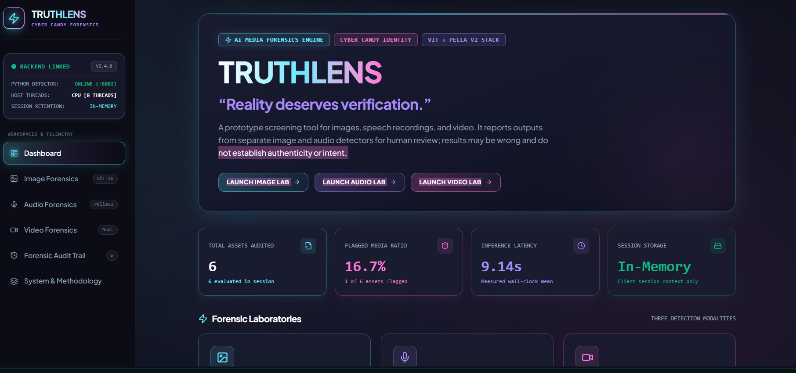

### 4.2 Image Forensics
**Image Upload**
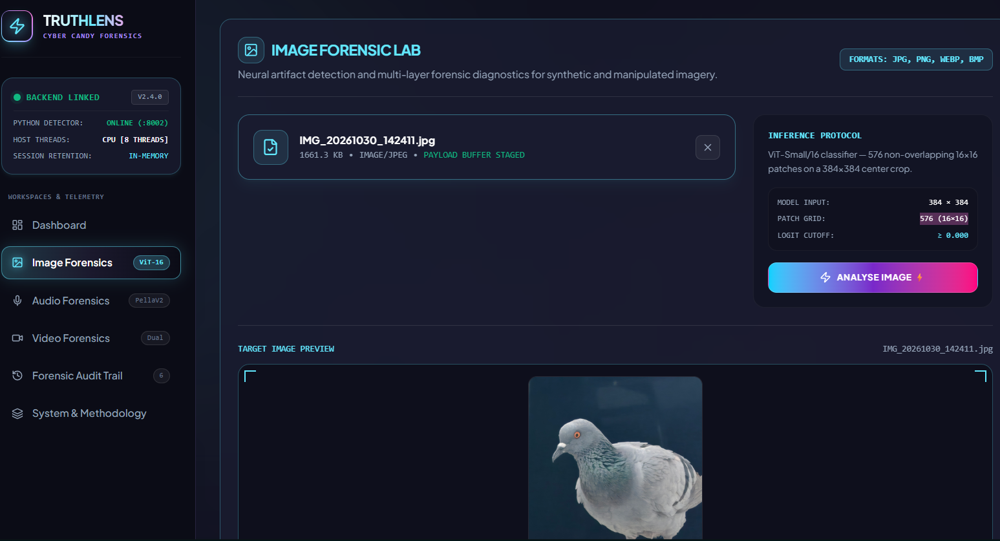

**Detection Results**
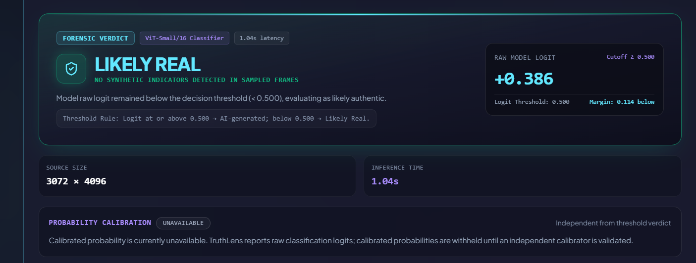

**Attribution Heatmap and Diagnostics**
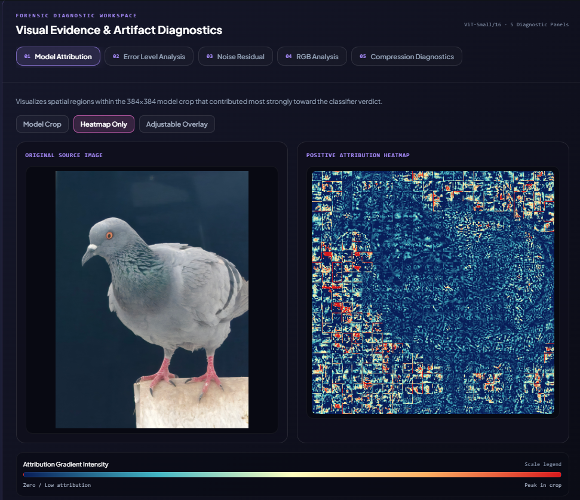

### 4.3 Audio Lab
**Audio Upload**
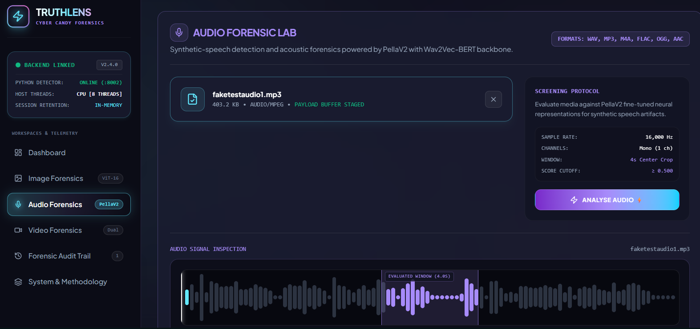

**Speech Analysis Results**
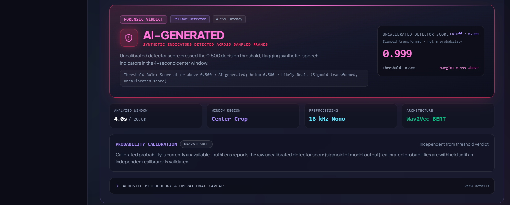

### 4.4 Video Lab
**Video Upload**
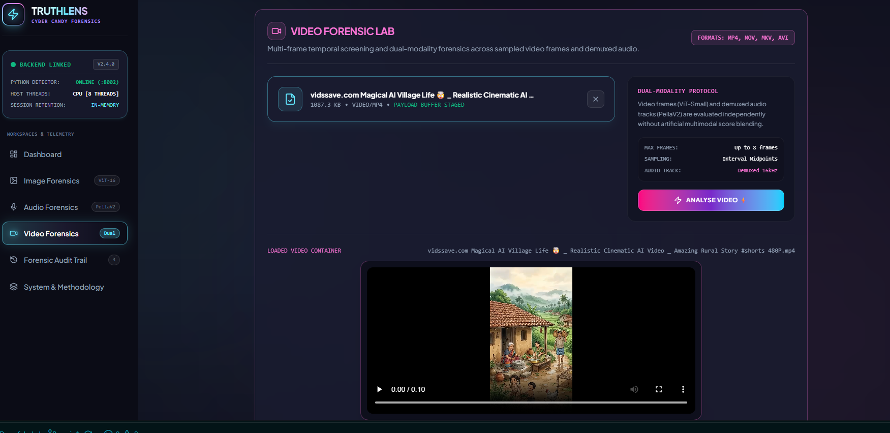

**Video Analysis Results**
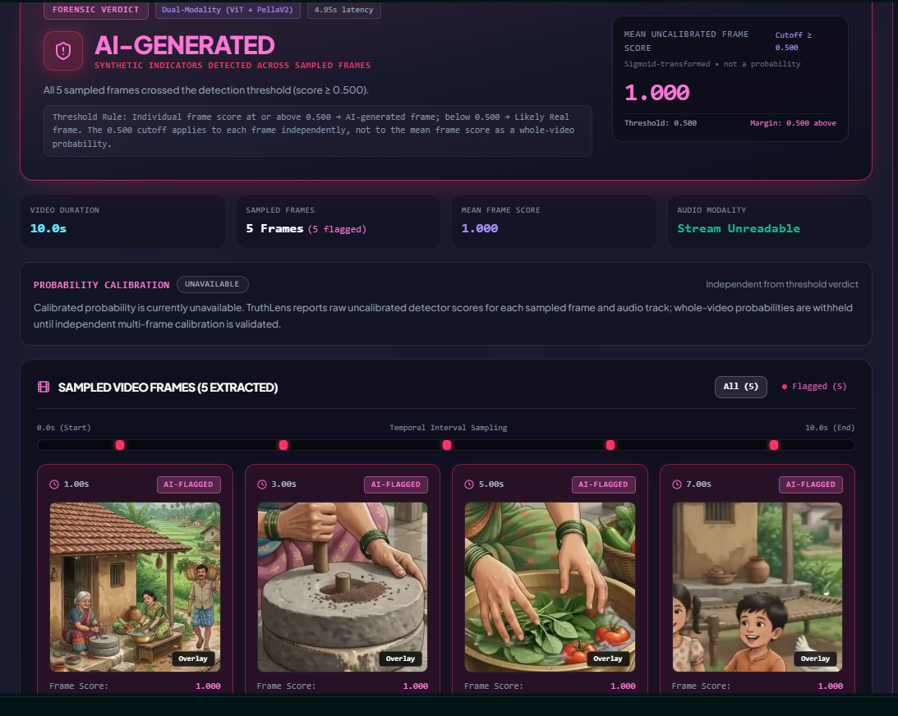

### 4.5 Forensic Audit
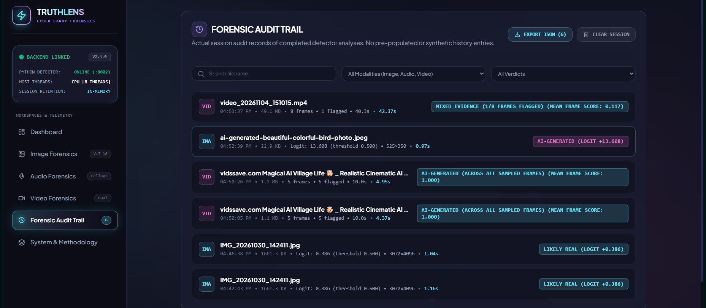

### 4.6 System Methodology
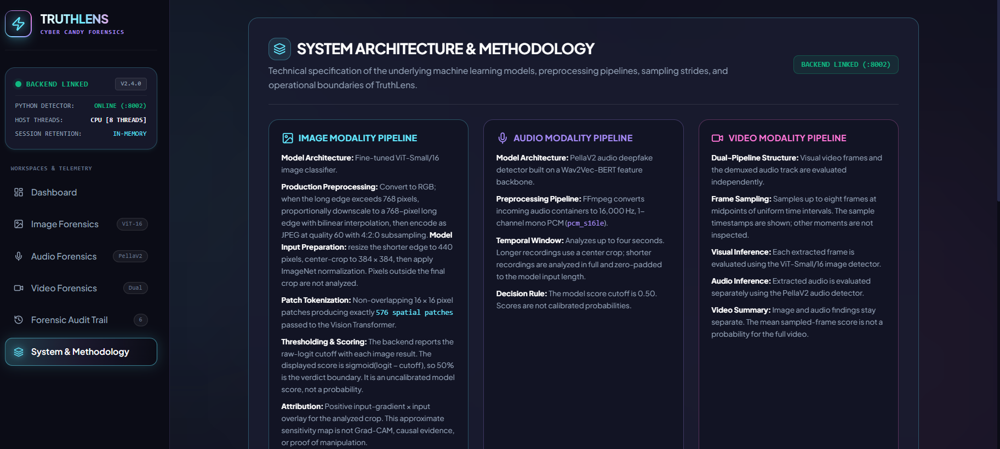
---

## 5. Measured Evaluation Results & Limitations

### Exploratory GenImage Evaluation

TruthLens was evaluated using a stratified 400-image subset containing 200 AI-generated images across eight generator architectures and 200 natural images from the Kaggle GenImage validation mirror:

**Dataset:** `vtphatt2/genimage-validation`  
**Dataset licence:** CC BY-NC-SA 4.0

The following results represent exploratory evaluation on this dataset. Threshold exploration was performed using the available sample; these results should not be interpreted as an independent, locked test benchmark or as guaranteed real-world performance.

| Operating Point | Threshold (Logit) | Accuracy | Precision | AI Recall | False Positive Rate |
|---|---:|---:|---:|---:|---:|
| Balanced (Default) | 0.0 | 90.5% | 97.65% | 83.0% | 2.0% |
| High-Precision Mode | 2.0 | 86.5% | 98.67% | 74.0% | 1.0% |

### Generator Robustness Breakdown

Exploratory detection results at a raw-logit threshold of 0.0:

- **Stable Diffusion v1.5:** 100.0%
- **Wukong:** 100.0%
- **GLIDE and SD v1.4:** 98.0%
- **Midjourney:** 94.0%
- **BigGAN:** 82.0%
- **VQDM:** 80.0%
- **ADM:** 72.0%

Results vary by generator architecture, and performance on this sample does not guarantee detection of unfamiliar future generators.

### Critical Forensic Limitations

- **Uncalibrated Scores:** Displayed sigmoid-transformed detector scores are not calibrated Bayesian posterior probabilities. A high score must not be interpreted as a validated percentage probability of AI generation.
- **Crop Limitation:** Image analysis inspects a central 384×384 crop. Manipulations located entirely outside the analysed crop may not be detected.
- **Acoustic Replay Limitation:** PellaV2 can identify synthetic vocoder characteristics in direct digital audio, but synthetic speech played through a physical speaker and re-recorded using a smartphone microphone may produce acoustic conditions that reduce detection reliability.
- **Temporal Blindspots:** Uniform sampling evaluates only up to eight frames. Brief manipulations occurring between sampled timestamps may not be captured.
- **Audio Availability:** PellaV2 requires sufficient available system memory. If the RAM preflight check fails, audio analysis is reported as unavailable rather than being presented as a completed analysis.
- **Human Review:** TruthLens is an assistive forensic screening tool. Its results should support, not replace, expert investigation and independent verification.

---

## 6. Local Setup & Execution Guide

### Prerequisites

- **Operating System:** Windows, macOS, or Linux.
- **Python:** 3.11 or 3.12.
- **Node.js:** 20.19+ or 22.12+.
- **npm:** Compatible version (included with Node.js).
- **FFmpeg and FFprobe:** Installed and available in the system `PATH`.
- **Memory:** Sufficient available RAM for the selected models. PellaV2 currently uses a default minimum RAM guard of 3.5 GB.

### 1. Backend Setup

Navigate to the repository root:

```powershell
Set-Location 'C:\Users\adora\DeepfakeLab'
```

Create a virtual environment if one does not already exist:

```powershell
python -m venv .venv
```

Activate it on Windows PowerShell:

```powershell
.\.venv\Scripts\Activate.ps1
```

Install backend dependencies:

```powershell
pip install -r requirements.txt
```

Start the FastAPI backend:

```powershell
$env:TRUTHLENS_IMAGE_LOGIT_THRESHOLD = "0.0"
$env:TRUTHLENS_PELLA_MIN_RAM_GB = "3.5"

python -m uvicorn src.api_server:app --host 127.0.0.1 --port 8002
```

The backend runs at:

`http://127.0.0.1:8002`

For macOS/Linux, activate the virtual environment using:

```bash
source .venv/bin/activate
```

Set the environment variables with:

```bash
export TRUTHLENS_IMAGE_LOGIT_THRESHOLD=0.0
export TRUTHLENS_PELLA_MIN_RAM_GB=3.5
```

### 2. Frontend Setup

Open a new terminal:

```powershell
Set-Location 'C:\Users\adora\DeepfakeLab\frontend'
```

Install frontend dependencies:

```powershell
npm install
```

Start the Vite development server:

```powershell
npm run dev
```

The frontend runs at:

`http://localhost:3000`

The Vite development server proxies `/api` requests to the FastAPI backend at `http://127.0.0.1:8002`.

---

## 7. Pretrained Models, Licences & Transparency

TruthLens uses externally developed pretrained models and openly available research components. Their original authors and sources are acknowledged below.

- **Image Detector Checkpoint:** `Thermostatic/community-forensics-frontier-detector-2026-08`, based on the ViT-Small/16 architecture.
- **Audio Detector:** `Sadanie/PellaV2`, using `facebook/w2v-bert-2.0` as its foundation representation.
- **Exploratory Evaluation Dataset:** GenImage validation subset from `vtphatt2/genimage-validation`, identified as CC BY-NC-SA 4.0.

The evaluation dataset and model checkpoints are not claimed as original work created by the TruthLens team.

### AI Tooling Disclosure

AI-assisted tools were used during development:

- **ChatGPT:** Planning, technical explanations, debugging assistance, and documentation support.
- **Gemini AI:** Development assistance and code-related support.
- **Claude Sonnet:** Code review, debugging assistance, and second opinions.
- **Antigravity:** AI-assisted code editing, refactoring, testing support, and project documentation.

AI tools assisted development; the project implementation, integration, testing, and final technical decisions were reviewed as part of the development process.

---

## 8. Automated Testing Suite

TruthLens includes backend and frontend tests to verify important application behaviour.

### Backend Tests

Run from the repository root:

```powershell
pytest tests/test_api_endpoints.py tests/test_detectors.py
```

### Frontend TypeScript Check

Run inside the frontend directory:

```powershell
npm run lint
```

### Frontend Production Build

```powershell
npm run build
```

### Frontend Test Suite

```powershell
node --import tsx --test tests/*.test.ts
```

The tests cover API endpoint behaviour, detector responses, score handling, image analysis contracts, audio/video response handling, and video verdict aggregation.

---

**TRUTHLENS • MULTIMODAL MEDIA FORENSICS • NEURAL STORM 2026**
